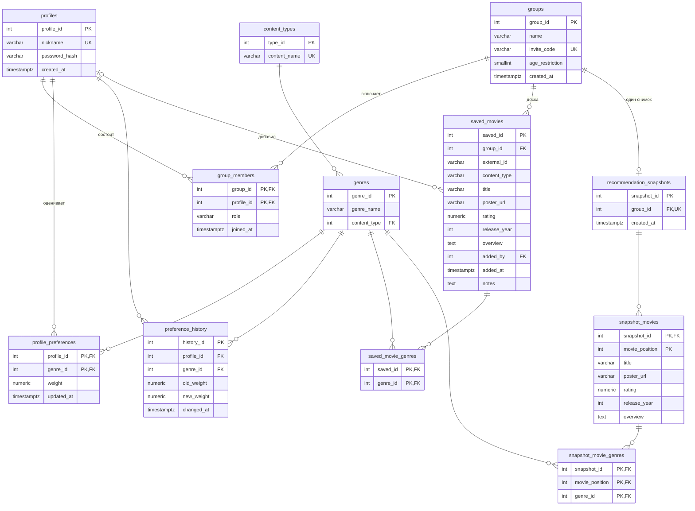
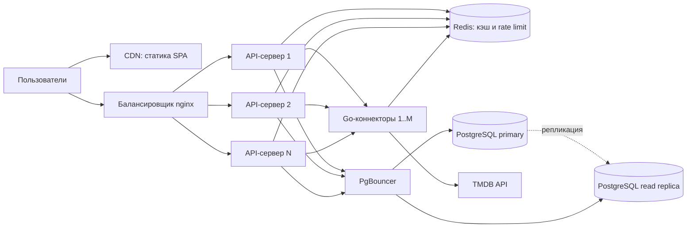

# CoPick

> **Ваш надежный напарник в мире развлечений**

Веб-сервис для совместного подбора фильмов в компании: каждый участник группы отмечает свои любимые и нелюбимые жанры, а сервис собирает из этого подборку, подходящую всем.

## Участники

| ФИО | Группа | Вклад |
|-----|--------|-------|
| Гаврилова Полина Вальерьевна | 5130904/40105 | работала |
| Карнаухова Александра Кирилловна | 5130904/40105 | чилл гай |
| Костюков Михаил | 5130904/40105 | вайб гай |
| Шапков Гордей | 5130904/40105 | клевый пацанчик |

Репозиторий: [ссылка]

---

## 1. Определение проблемы

Когда компания из 3–10 человек выбирает фильм, каждый предлагает своё, и на спор уходит 30–40 минут. Мессенджеры не агрегируют предпочтения участников и не показывают, какой вариант подходит большинству. В итоге выбор делается наугад или по настойчивости самого активного, а остальные остаются недовольны.

---

## 2. Выработка требований

### Пользовательские истории

1. **Когда** я собираюсь посмотреть фильм с друзьями, **я хочу** создать группу и позвать участников по короткому коду, **чтобы** все оказались в одном пространстве без обмена личными данными.
2. **Когда** я захожу в сервис, **я хочу** оценить жанры от «категорически не нравится» до «обожаю», **чтобы** сервис учитывал мои вкусы при выборе для группы.
3. **Когда** кто-то из группы находит интересный фильм, **я хочу** добавить его на общую доску группы с постером, рейтингом и описанием, **чтобы** все видели варианты в одном месте.
4. **Когда** вся группа оценила жанры, **я хочу** получить подборку фильмов, подходящих всем участникам (при желании выбрав, кто сегодня смотрит и какие жанры хочется именно сегодня), **чтобы** не тратить время на споры.
5. **Когда** состав компании меняется, **я хочу**, чтобы владелец мог исключать участников и обновлять код приглашения, **чтобы** контролировать, кто видит данные группы.

### Оценка нагрузки (допущения)

| Параметр | Значение |
|----------|----------|
| Активных пользователей в сутки (DAU) | 10 000 |
| Зарегистрированных профилей | ~50 000 |
| Запросов на пользователя в сутки | ~30 |
| Период хранения данных | > 5 лет |

---

## 3. Архитектура и детальное проектирование

### 3.1. Характер нагрузки

**Запросы.** 10 000 DAU × 30 запросов = 300 000 запросов/сутки ≈ **3,5 RPS** в среднем. Вечерний пик (пятница) примерно в 10 раз выше, то есть **~35 RPS**.

**Соотношение R/W ≈ 90 / 10.** Пользователи в основном просматривают группы и доску и значительно реже меняют предпочтения или добавляют фильмы.

**Трафик.** Средний ответ API около 5 КБ (изображения грузятся браузером напрямую с CDN TMDB по `poster_url` и через сервис не проходят). 300 000 × 5 КБ ≈ **1,5 ГБ/сутки** исходящего трафика, в пике около 175 КБ/с.

**Объём хранилища (5 лет).**

| Таблицы | Оценка | За 5 лет |
|---------|--------|----------|
| `profiles`, `groups`, `group_members` | 50 000 профилей, ~20 000 групп, малый размер строк | < 100 МБ |
| `profile_preferences` | 50 000 × ~15 жанров × ~50 Б | ~40 МБ |
| `preference_history` | ~20 000 записей/сутки × ~80 Б ≈ 1,6 МБ/сутки | ~3 ГБ |
| `saved_movies` + `saved_movie_genres` | ~5 000 добавлений/сутки × ~1,5 КБ (с `overview`) ≈ 7,5 МБ/сутки | ~14 ГБ |
| `recommendation_snapshots` и связанные | один снимок на группу: ~20 000 × ~10 фильмов × 1,5 КБ | ~0,3 ГБ |
| Индексы и накладные расходы | ×1,5 | |
| **Итого** | | **≈ 25 ГБ** |

Такой объём помещается на одном узле PostgreSQL.

### 3.2. C4. Диаграмма контекста (уровень 1)


Пользователь работает с CoPick через браузер. Единственная внешняя система — TMDB API, источник метаданных о фильмах (названия, постеры, рейтинги, описания, жанры).

### 3.3. C4. Диаграмма контейнеров (уровень 2)


| Контейнер | Технологии | Ответственность |
|-----------|-----------|-----------------|
| Веб-клиент | React, TypeScript, Vite, Tailwind CSS, Axios | Интерфейс управления группами, предпочтениями, доской и просмотра рекомендаций |
| API-сервер | Java 17, Spring Boot 3, Spring Security, Spring Data JPA | Бизнес-логика, JWT-аутентификация, права доступа, алгоритм рекомендаций, REST API |
| Connector | Go 1.26.0 | Загрузка и кэширование метаданных из TMDB |
| База данных | PostgreSQL | Профили, группы, предпочтения и их история, доска, снимки рекомендаций |

Коннектор вынесен в отдельный сервис, чтобы медленные сетевые вызовы к внешнему API не занимали потоки основного Java-бэкенда, а ключ и лимиты TMDB были изолированы в одном месте.

### 3.4. Контракты API и нефункциональные требования

Базовый префикс: `/api/v1`. Все эндпоинты, кроме `/auth/register` и `/auth/login`, требуют `Authorization: Bearer <JWT>`. Идентификатор текущего профиля берётся из токена.

| Метод | Путь | Описание | Права | Ответ | Целевое p95 |
|-------|------|----------|-------|-------|-------------|
| POST | `/auth/register` | Регистрация (`nickname`, `password`) | все | 201, `{token, profile}` | 300 мс |
| POST | `/auth/login` | Вход | все | 200, `{token, profile}` | 300 мс |
| PATCH | `/auth/me` | Смена никнейма и/или пароля (`nickname`, `oldPassword`, `newPassword`) | владелец профиля | 200, `ProfileDto` | 300 мс |
| GET | `/genres` | Справочник жанров | авторизованный | 200, список | 50 мс |
| GET | `/profiles/me/preferences` | Мои оценки жанров | авторизованный | 200, список | 100 мс |
| PUT | `/profiles/me/preferences` | Задать оценки жанров списком (вес от -1.0 до 1.0) | авторизованный | 200, список | 200 мс |
| DELETE | `/profiles/me/preferences/{genreId}` | Удалить одну оценку | авторизованный | 204 | 100 мс |
| DELETE | `/profiles/me/preferences` | Удалить все оценки | авторизованный | 204 | 100 мс |
| GET | `/groups` | Мои группы (роль, число участников) | авторизованный | 200, список | 150 мс |
| POST | `/groups` | Создать группу (`name`, `ageRestriction`) | авторизованный | 200, `GroupDetailsDto` | 200 мс |
| POST | `/groups/join` | Вступить по коду (`inviteCode`) | авторизованный | 200, `GroupDetailsDto` | 200 мс |
| GET | `/groups/{id}` | Детали группы и участники | член группы | 200, `GroupDetailsDto` | 150 мс |
| DELETE | `/groups/{id}` | Удалить группу | owner | 204 | 200 мс |
| DELETE | `/groups/{id}/members/{memberProfileId}` | Исключить участника | owner | 204 | 150 мс |
| POST | `/groups/{id}/regenerate-invite` | Новый код приглашения | owner | 200, `{inviteCode}` | 150 мс |
| POST | `/groups/{id}/leave` | Покинуть группу | член группы | 204 | 150 мс |
| GET | `/groups/{groupId}/saved` | Доска группы | член группы | 200, список | 250 мс |
| POST | `/groups/{groupId}/saved` | Добавить фильм на доску | член группы | 201, `SavedMovieResponseDto` | 300 мс (с обращением к коннектору до 800 мс) |
| DELETE | `/groups/{groupId}/saved/{savedId}` | Убрать фильм с доски | член группы | 204 | 150 мс |
| GET | `/groups/{id}/recommendations` | Расчёт подборки. Параметры: `genreIds` (жанры «на сегодня»), `profileIds` (кто смотрит; по умолчанию вся группа), `limit` (по умолчанию 10) | член группы [проверить] | 200, список `ScoredMovie` (`movieId`, `finalScore`, `genreIds`, `qualityScore`) | [уточнить: 800 мс] |
| GET | `/groups/{id}/recommendations/stats` | Статистика группы: число участников, топ жанров (средний и минимальный вес), запрещённые жанры | член группы [проверить] | 200, `GroupStatsResponse` | 300 мс |
| GET | `/groups/{id}/recommendations/last` | Последний сохранённый снимок рекомендаций с постерами, рейтингами и жанрами | член группы [проверить] | 200, список `SnapshotMovieResponse` | 200 мс |

> Поиск фильмов через коннектор в присланных контроллерах не встречался: если он есть, добавьте его в таблицу. Проверку членства в группе для рекомендаций тоже стоит сверить с кодом сервиса.

**Пример: добавление фильма на доску**

```http
POST /api/v1/groups/42/saved
Authorization: Bearer <JWT>

{ "externalId": "603", "contentType": "movie", ... }

201 Created
{
  "savedId": 17,
  "groupId": 42,
  "externalId": "603",
  "contentType": "movie",
  "title": "Матрица",
  "originalTitle": "The Matrix",
  "posterUrl": "https://image.tmdb.org/...",
  "rating": 8.2,
  "releaseYear": 1999,
  "genres": ["Боевик", "Фантастика"],
  "addedByProfileId": 5,
  "addedByNickname": "neo",
  "addedAt": "2026-11-10T19:00:00+01:00"
}
```

**Коды ошибок:** `400` — невалидные данные, `401` — нет или просрочен JWT, `403` — нет прав (не owner или не член группы), `404` — группа или запись не найдены, `409` — конфликт (дубликат на доске, занятый никнейм).

**Общие нефункциональные требования**
- p95 для чтения ≤ 300 мс при 35 RPS;
- доступность 99%;
- пароли хранятся как хэши (`password_hash`), аутентификация без состояния (JWT);
- ошибка внешнего API (TMDB) не должна ломать остальной функционал: чтение групп, доски и предпочтений работает без коннектора.

### 3.5. Алгоритм рекомендаций

Алгоритм (`CoPickAlgorithm`) работает в памяти API-сервера и не обращается к БД: все данные ему передаются на вход.

**Вход**
- оценки жанров участников (`genreWeights`, вес от -1 до 1; `profileIds` позволяет выбрать, кто сегодня смотрит, по умолчанию вся группа);
- жанры контекста (`genreIds`): то, чего группе хочется именно сегодня;
- кандидаты: фильмы с жанрами и рейтингом TMDB (`MovieCandidate`);
- флаг диверсификации (MMR).

**Шаг 1. Личная оценка фильма участником.** Берётся среднее по весам жанров фильма (жанры, которые участник не оценил, дают 0) и добавляется штраф за самый нелюбимый жанр:

```
personal = max(-1, mean(w_g) + λ · min(0, min w_g))
```

Вето: если участник поставил жанру ровно -1, а жанр не входит в контекст, фильм получает для этого участника `-1` сразу. Если такой жанр в контексте, вето смягчается: вес заменяется на `-κ`.

**Шаг 2. Групповая оценка.** Баланс между «хорошо в среднем» и «никого не обидеть»: берётся среднее личных оценок и среднее оценок самой недовольной четверти группы (`k = max(1, n/4)` худших оценок):

```
group = α · mean(personal) + (1 − α) · mean(худшие k оценок)
```

**Шаг 3. Итоговый скор.** К групповой оценке добавляются бонус за совпадение с жанрами контекста и поправка на качество фильма (рейтинг TMDB от 0 до 10 приводится к диапазону от -0.5 до 0.5):

```
final = group + β · [есть жанр из контекста] + ρ · (rating − 5) / 10
```

Фильмы сортируются по `final` по убыванию, при равенстве — по качеству, затем по `movieId` (детерминированный порядок).

**Шаг 4 (опционально). Диверсификация MMR.** Чтобы в топе не оказалось десяти похожих боевиков, берётся верхний пул из `M` фильмов, скоры нормируются в диапазон [0; 1], и фильмы выбираются жадно:

```
mmr = μ · score_norm − (1 − μ) · max(Jaccard(жанры фильма, жанры уже выбранных))
```

**Профиль группы** (`/recommendations/stats`): средний вес каждого жанра по группе, список запрещённых жанров (хотя бы у одного участника вес -1 и жанра нет в контексте) и коэффициенты влияния, то есть доли положительных средних весов, сумма которых равна 1.

**Гиперпараметры** (`AlgorithmConfig`):

| Параметр | Смысл | Значение |
|----------|-------|----------|
| α | вес среднего против «худшей четверти» в групповой оценке | [значение] |
| β | бонус за жанр контекста | [значение] |
| ρ | вес рейтинга TMDB | [значение] |
| λ | штраф за самый нелюбимый жанр | [значение] |
| κ | смягчённый вес для вето-жанра из контекста | [значение] |
| μ | баланс релевантности и разнообразия в MMR | [значение] |
| M | размер пула для MMR | [значение] |

**Снимок.** Результат расчёта сохраняется в `recommendation_snapshots` / `snapshot_movies` (по одному снимку на группу). `GET /recommendations/last` отдаёт последний снимок с полными данными фильмов без повторного расчёта. [Проверьте: снимок обновляется при каждом вызове `GET /recommendations`.]

**Сложность.** Расчёт идёт за `O(|кандидаты| · n · g)` (n участников, g жанров фильма), MMR добавляет `O(M²)`. При n ≤ 10 и сотнях кандидатов это единицы миллисекунд, поэтому узким местом остаётся не алгоритм, а получение кандидатов у коннектора.

### 3.6. Схема базы данных



На схеме для краткости опущены часть полей `saved_movies` и `snapshot_movies` (`original_title`, `backdrop_url`). Схема создаётся SQL-миграциями через `golang-migrate`; справочники `content_types` и `genres` (19 жанров для `movie`) заполняются начальной миграцией.

**Ограничения и целостность**
- `profiles.nickname`, `groups.invite_code` — `UNIQUE`; `genres` — `UNIQUE (genre_name, content_type)`.
- Проверки значений: `profile_preferences.weight` и `preference_history.old_weight/new_weight` — `CHECK (between -1 and 1)`, `groups.age_restriction` — `CHECK (between 0 and 21)`.
- Защита от дублей: `saved_movies` — `UNIQUE (group_id, external_id, content_type)`, `recommendation_snapshots.group_id` — `UNIQUE`.
- `ON DELETE CASCADE`: при удалении группы чистятся участники, доска и снимок; при удалении профиля — членство, оценки и история; при удалении жанра — связанные оценки и связи.
- `ON DELETE SET NULL`: `saved_movies.added_by`, то есть фильм остаётся на доске группы, если добавивший его профиль удалён.
- Роль участника (`owner` / `member`) хранится в `group_members.role`, владелец группы определяется ею.
- Жанры нормализованы: связи «фильм — жанр» хранятся в отдельных таблицах, без строк с перечислением.

**Индексы:** первичные и уникальные ключи создают индексы автоматически (в том числе `(group_id, profile_id)` для проверки членства, `(group_id, external_id, content_type)` для защиты от дублей). Дополнительно созданы `idx_snapshot_movies_snapshot_id` и `idx_snapshot_movie_genres_snapshot_id` для чтения снимка группы. Для списка «мои группы» полезен индекс по `group_members(profile_id)`: [добавлен / планируется добавить].

**Почему схема выдерживает нагрузку.** При ~35 RPS в пике и ~25 ГБ данных за 5 лет все основные запросы идут по первичным или составным ключам и обслуживаются индексами. Списки с вложенными сущностями (доска с жанрами и авторами) загружаются через `@EntityGraph` и `JOIN FETCH`, что исключает проблему N+1. Рекомендации читаются из готового снимка (один на группу), а не пересчитываются при каждом запросе. Метаданные фильма копируются в `saved_movies` и `snapshot_movies`, поэтому показ доски и рекомендаций не требует обращения к TMDB: это сознательная денормализация в обмен на скорость чтения и независимость от внешнего API. Самая быстрорастущая таблица, `preference_history`, работает только на добавление и читается по `profile_id`, её при необходимости можно партиционировать по времени.

### 3.7. Масштабирование при росте нагрузки в 10 раз

Цель: 100 000 DAU, ~350 RPS в пике, ~250 ГБ данных за 5 лет.



1. **API-серверы горизонтально.** Сервис не хранит состояние (JWT), а алгоритм рекомендаций считается в памяти без обращения к БД, поэтому нагрузка равномерно делится между 3–4 репликами за балансировщиком.
2. **База данных.** Пул соединений через PgBouncer; чтения (группы, доска, снимки) уходят на read-реплику, запись остаётся на primary (при R/W = 90/10 это снимает основную нагрузку). `preference_history` партиционируется по месяцам.
3. **Кэш.** Redis для справочника жанров, метаданных TMDB и rate limiting: меньше обращений к БД и внешнему API.
4. **Коннектор.** Масштабируется независимо (лёгкие Go-реплики), лимиты запросов к TMDB контролируются централизованно.
5. **Статика.** SPA отдаётся через CDN, нагрузку на бэкенд не создаёт.
6. **Дальнейший рост.** Шардирование по `group_id` и брокер сообщений для асинхронного пересчёта снимков рекомендаций.

---

## 4. Кодирование и отладка

| Компонент | Технологии |
|-----------|-----------|
| Backend | Java 17, Spring Boot 3, Spring Security (JWT), Spring Data JPA, Hibernate |
| Frontend | React, TypeScript, Tailwind CSS, Vite, Axios |
| БД | PostgreSQL, миграции `golang-migrate` |
| Connector | Go |

Структура репозитория:

```
/backend      # Spring Boot (пакеты auth, profiles, groups, preferences, saved, recommendations)
/frontend     # React SPA
/connector    # Go-сервис для TMDB
/migrations   # SQL-миграции
/docs         # диаграммы
docker-compose.yml
```

Ключевые решения:
- проверка прав на уровне сервисного слоя (только owner удаляет группу и исключает участников, владельца через эндпоинт кика исключить нельзя, членство проверяется перед просмотром группы и доски);
- алгоритм рекомендаций с «справедливой» групповой оценкой (учитывает самых недовольных участников), вето на нелюбимые жанры и диверсификацией выдачи (MMR);
- уникальный 8-значный код приглашения с возможностью перевыпуска владельцем;
- `@EntityGraph` / `JOIN FETCH` против N+1;
- целостность данных обеспечивается каскадами на уровне БД;
- тяжёлые обращения к внешнему API вынесены в отдельный Go-сервис.

Вклад каждого участника виден в [истории коммитов]([ссылка]/commits).

---

## 5. Unit-тестирование

Запуск: `cd backend && ./mvnw test`

Покрыто: [заполнить по факту; примеры того, что имеет смысл тестировать]
- генерация и перевыпуск кода приглашения;
- права доступа: владельца нельзя исключить, не-owner не может удалить группу или исключить участника, не-член не видит группу и доску;
- валидация веса предпочтения (границы -1 и 1);
- запись в `preference_history` при изменении предпочтения;
- обработка дубликата при добавлении фильма на доску;
- алгоритм рекомендаций: вето на жанр с весом -1 (и его смягчение, если жанр в контексте), фильм с жанрами, нравящимися всем, выигрывает у фильма, который нравится части группы и категорически не нравится одному участнику, бонус за жанры контекста, детерминированная сортировка при равных скорах, MMR не ставит подряд фильмы одного жанра, пустой список кандидатов.

---

## 6. Интеграционное тестирование

Сценарий, покрывающий пользовательские истории «создать группу и пригласить» и «общая доска»:

1. Пользователь A регистрируется и входит (получает JWT).
2. A создаёт группу и получает код приглашения.
3. Пользователь B регистрируется и вступает в группу по коду.
4. B добавляет фильм на доску группы.
5. A видит этот фильм в списке с жанрами и автором.
6. A исключает B; B теряет доступ к доске (`403`).

Реализация: [Testcontainers (PostgreSQL) / тестовый профиль docker compose], запуск: `[команда]`.

---

## 7. Сборка и запуск

```bash
git clone [ссылка]
cd copick
cp .env.example .env     # TMDB_API_KEY, JWT_SECRET, параметры БД
docker compose up --build
```

После запуска:
- Frontend: http://localhost:[порт]
- Backend API: http://localhost:[порт]/api/v1
- Connector: http://localhost:[порт]

Сервисы в `docker-compose.yml`: `postgres`, `migrate` (golang-migrate), `backend`, `connector`, `frontend`.
